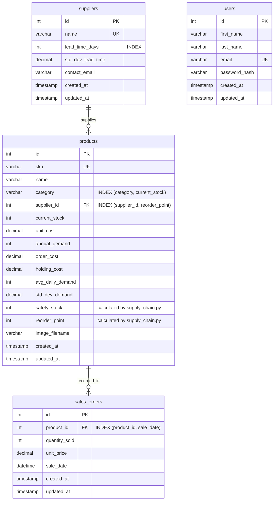

# Dynamic Inventory Decision Support System (DIDSS)

**BFB 321 Supply Chain Digital Technology · Group 3 · TapHouse Sports Bar and Grill**

A web application that helps the TapHouse manager decide **when and how much beverage stock to
reorder**. It stores products, suppliers and point-of-sale history in MySQL, and the supply chain
model (`supply_chain.py`) turns demand variability and supplier lead-time variability into a
safety stock, a reorder point and an economic order quantity for every product, at a 95% target
service level. The dashboard shows live stock status, KPIs and alerts calculated from the database.

Stack: HTML/CSS/Bootstrap frontend · Flask backend · MySQL (local or Aiven) · Python supply chain model.

## Team

| Member | Student number | GitHub username |
|---|---|---|
| Thejas Nirghin | u22493523 | [u22493523](https://github.com/u22493523) |
| Nehar Lalla | u23524848 | [NEHAR-GITHUB-USERNAME](https://github.com/NEHAR-GITHUB-USERNAME) |

### Task allocation

| Task | Member | Commits |
|---|---|---|
| Step 1: frontend dashboard, styles and images | Thejas Nirghin | *Add Step 1 frontend dashboard, styles, and images* |
| Step 2: supply chain model and unit tests | Nehar Lalla | *Add Step 2 Python supply chain logic and tests*; *Step 2: move supply chain formulas into supply_chain.py* |
| Step 3: 3NF schema, seed data, PyMySQL connection, init script, live dashboard | Thejas Nirghin | *Step 3 (1/3)* to *Step 3 (3/3)* |
| Step 3 fixes: model-calculated safety stock and reorder points, live alerts, README | Nehar Lalla | *Step 3 fix: …* |
| Step 4: REST API, validation, error handling, logging, config, API tests | Nehar Lalla | *Step 4 (1/4)* to *Step 4 (4/4)* |

## Project structure

Follows the class sample project ([bfb321/FLASK](https://github.com/bfb321/FLASK)): each file has one job.

```
BFB321_group3/
├── app.py              routes: reads the request, calls models, renders templates
├── models.py           SQL queries and business rules (no HTML, no routes)
├── supply_chain.py     Step 2 model: EOQ, safety stock, reorder point (no database code)
├── db.py               MySQL connection from .env, one connection per request, query helpers
├── init_db.py          creates the tables, loads the sample data, runs the model
├── schema.sql          CREATE TABLE statements
├── seed.sql            sample data (4 suppliers, 12 products, 36 sales, 1 manager)
├── requirements.txt    Python packages
├── .env.example        template for your .env file (no real passwords)
├── templates/          index.html (dashboard)
├── static/             css/main.css, images/
└── tests/              test_inventory.py (unit tests), VScode_Testing.py (quick manual run)
```

```
Browser → app.py (route) → models.py (SQL + rules) → db.py (connection) → MySQL
                                   ↘ supply_chain.py (formulas)
```

## Database

### Entity relationship diagram (3NF)



- **Relationships:** one supplier supplies many products (`products.supplier_id` → `suppliers.id`),
  and one product appears in many sales (`sales_orders.product_id` → `products.id`). Both are
  one-to-many, so no link table is needed. `users` is a standalone table for manager logins.
- **3NF:** supplier details (lead time, email) are stored once in `suppliers`, not repeated in
  every product row. `sales_orders.unit_price` copies the price at the time of sale so later price
  changes never rewrite history.
- **Constraints:** `NOT NULL` on required fields, `UNIQUE` on supplier name, SKU and user email,
  `CHECK` constraints so stock, costs, demand and quantities can't be negative, and foreign keys
  with `ON DELETE RESTRICT` so a supplier or product with history can't be deleted by accident.
- **Money** uses `DECIMAL(10,2)`. **Audit fields** `created_at` and `updated_at` are on every table;
  `updated_at` changes automatically (`ON UPDATE CURRENT_TIMESTAMP`).
- **Indexes:** `idx_suppliers_lead_time (lead_time_days)`, `idx_products_category_stock (category,
  current_stock)`, `idx_products_supplier_rop (supplier_id, reorder_point)` and
  `idx_sales_product_date (product_id, sale_date)`.

### How the supply chain model sets safety stock and reorder points

`safety_stock` and `reorder_point` are not typed into `seed.sql`. When the database is built,
`init_db.py` reads each product's demand and its supplier's lead time and calls `supply_chain.py`:

| Quantity | Formula |
|---|---|
| Safety stock | SS = z · √( L·σ_d² + d²·σ_L² ), with z = 1.645 for 95% |
| Reorder point | ROP = d·L + SS |
| Economic order quantity | EOQ = √( 2DS / H ) |

Example, Lager 500ml: d = 10, σ_d = 3.2, L = 4 days, σ_L = 1 day →
SS = 1.645 × √(4 × 3.2² + 10² × 1²) = 19.5 → **20**, ROP = 10 × 4 + 20 = **60**.

Stock status is calculated, never typed in:

| Condition | Status |
|---|---|
| `current_stock <= safety_stock` | URGENT |
| `current_stock <= reorder_point` | REORDER |
| otherwise | OK |

## How to run the application

### 1. Get the code

```bash
git clone https://github.com/u22493523/BFB321_group3.git
cd BFB321_group3
```

### 2. Create a virtual environment and install the packages

```bash
# Windows
python -m venv venv
.\venv\Scripts\activate

# macOS / Linux
python3 -m venv venv
source venv/bin/activate

pip install -r requirements.txt
```

Your terminal prompt starts with `(venv)` when the environment is active.

### 3. Configure the database connection

```bash
copy .env.example .env      # Windows
cp .env.example .env        # macOS / Linux
```

Open `.env` and fill in your MySQL details. For a local MySQL Workbench server keep
`DB_HOST=127.0.0.1` and `DB_PORT=3306`; for Aiven use the host, port, user and password from
**Service → Overview → Connection information**. Create an empty database named `taphouse_didss`
first (`CREATE DATABASE taphouse_didss;`). `.env` is listed in `.gitignore`: never commit it.

### 4. Create the tables, load the sample data and run the model

```bash
python init_db.py
```

Expected output:

```
Creating tables from schema.sql ...
Loading sample data from seed.sql ...
  suppliers     4 rows
  products      12 rows
  sales_orders  36 rows
  users         1 rows
Calculated safety stock and reorder point for 12 products at a 95% service level (supply_chain.py)
Done. Now run:  python app.py
```

Running it again is safe: sample data is only loaded when `products` is empty. To delete
everything and rebuild from scratch:

```bash
python init_db.py --reset
```

### 5. Start the app

```bash
python app.py
```

Open <http://127.0.0.1:5000>. Stop the server with `Ctrl+C`.

### Test login

| Email | Password |
|---|---|
| `manager@taphouse.co.za` | `TapHouse2026!` |

### Run the tests

```bash
python -m unittest discover -s tests -p "test_*.py"
```

## Quick check

With fresh sample data the dashboard shows:

- 5 products at or below their reorder point (Lager 500ml, Tonic Water, Draught Keg 30L,
  Soda Water 200ml, Rosé Wine 750ml), each with a REORDER badge and an EOQ order quantity
- An alert that Lager 500ml demand is 54% above expected over the last 7 days
- Inventory value R 17,856.80

## Troubleshooting

| Message | Fix |
|---|---|
| `Can't connect to MySQL server` | MySQL is not running, or `DB_HOST` / `DB_PORT` is wrong. On Aiven, power the service on and wait for **Running** |
| `Access denied for user` | `DB_USER` or `DB_PASSWORD` is wrong |
| `Unknown database` | Create the `taphouse_didss` database first, or fix `DB_NAME` |
| `No module named 'flask'` / `'pymysql'` | Activate the virtual environment, then `pip install -r requirements.txt` |
| `Table doesn't exist` after editing `schema.sql` | Run `python init_db.py --reset` |
