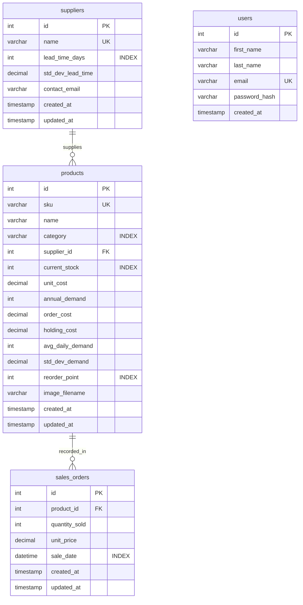

## Project Title
# Dynamic Inventory Decision Support System (DIDSS)

## Project Description
A web-based inventory decision support system for TapHouse Sports Bar and Grill. This project dynamically calculates safety stock, reorder points, and recommended replenishment quantities to handle demand variability and supplier lead times.

## Group Members
- Nehar Lalla - u23524848
- Thejas Nirghin - u22493523

## Database Architecture & Entity Relationship Diagram (3NF)

The MySQL database is normalised to Third Normal Form (3NF) across four tables (`suppliers`, `products`, `sales_orders`, and `users`):

- **Relationships:** `suppliers` has a one-to-many (`1:N`) relationship with `products` (`products.supplier_id` → `suppliers.id`), and `products` has a one-to-many (`1:N`) relationship with `sales_orders` (`sales_orders.product_id` → `products.id`). `users` is a standalone authentication table for manager login credentials.
- **Indexes:** `idx_suppliers_lead_time (lead_time_days)`, `idx_products_category_stock (category, current_stock)`, `idx_products_supplier_rop (supplier_id, reorder_point)`, and `idx_sales_product_date (product_id, sale_date)`.

## Installation and Setup Instructions
This repository currently contains the deliverables for **Step 1 (Frontend UI)**, **Step 2 (Python Supply Chain Model)**, and **Step 3 (3NF MySQL Database & Flask Integration)**.

**1. Set Up the Python Virtual Environment**
- Open a terminal in the root `BFB321_group3` directory.
- Create and activate a virtual environment:
  - Windows: `python -m venv venv` then `.\venv\Scripts\activate`
  - macOS / Linux: `python3 -m venv venv` then `source venv/bin/activate`
- Install all required packages: `pip install -r requirements.txt`

**2. Configure Database Credentials (`.env`)**
- Copy `.env.example` to `.env` (`copy .env.example .env` on Windows or `cp .env.example .env` on macOS/Linux).
- Open `.env` and enter your MySQL / Aiven host, port, username, password, database name, and `SECRET_KEY`.

**3. Initialise & Seed the MySQL Database**
- Create the tables from `schema.sql` and load sample data from `seed.sql` by running:
  `python init_db.py`
- To drop existing tables and rebuild from scratch, run:
  `python init_db