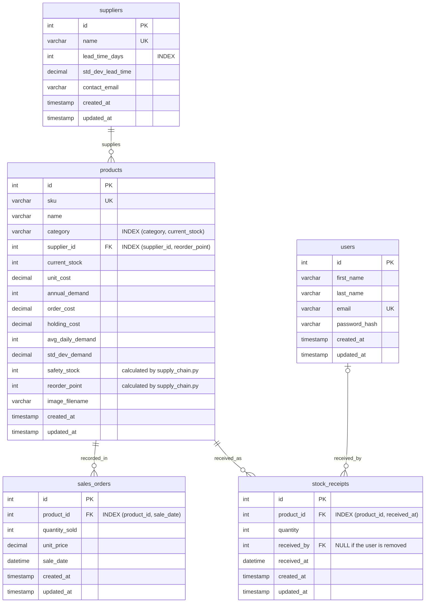

# Dynamic Inventory Decision Support System (DIDSS)

**BFB 321 Supply Chain Digital Technology · Group 3 · TapHouse Sports Bar and Grill**

A web application that helps the TapHouse manager decide **when and how much beverage stock to
reorder**. It stores products, suppliers and point-of-sale history in MySQL, and the supply chain
model (`supply_chain.py`) turns demand variability and supplier lead-time variability into a
safety stock, a reorder point and an economic order quantity for every product, at a 95% target
service level. The dashboard shows live stock status, KPIs and alerts calculated from the database.

Stack: HTML/CSS/Bootstrap frontend · Flask backend · MySQL (local or Aiven) · Python supply chain model.

## Team

| Member | Student number | GitHub username |
|---|---|---|
| Thejas Nirghin | u22493523 | [u22493523](https://github.com/u22493523) |
| Nehar Lalla | u23524848 | [Nehar-Lalla](https://github.com/Nehar-Lalla) |

### Task allocation

| Task | Member | Commits |
|---|---|---|
| Step 1: frontend dashboard, styles and images | Thejas Nirghin | *Add Step 1 frontend dashboard, styles, and images* |
| Step 2: supply chain model and unit tests | Nehar Lalla | *Add Step 2 Python supply chain logic and tests*; *Step 2: move supply chain formulas into supply_chain.py* |
| Step 3: 3NF schema, seed data, PyMySQL connection, init script, live dashboard | Thejas Nirghin | *Step 3 (1/3)* to *Step 3 (3/3)* |
| Step 3 fixes: model-calculated safety stock and reorder points, live alerts, README | Nehar Lalla | *Step 3 fix: …* |
| Step 4: REST API blueprint, validation, error handling, logging, config, API tests | Nehar Lalla | *Step 4 (1/4)* to *Step 4 (4/4)* |
| Step 5: manager login, CSV import, receive orders, scenario evaluation, live dashboard (fetch) | Thejas Nirghin | *Step 5 (1/4)* to *Step 5 (4/4)* |
| Step 6: migrations with rollback, backup and restore, health check, audit trail, production setup | Nehar Lalla | *Step 6 (1/4)* to *Step 6 (4/4)* |
| Step 7: impact simulation (before/after KPIs and charts), scalability test and dashboard speed-up | Thejas Nirghin | *Step 7 (1/3)* to *Step 7 (3/3)* |

## Features

| Page | Description |
|---|---|
| **Dashboard** | Live overview of inventory KPIs, stock status counts, weekday demand chart, and reorder alerts |
| **Inventory Master** | Add, view, and update beverage products with model-calculated safety stock and reorder points |
| **Stock & Sales Tracking** | Log daily sales, upload till CSV exports, and record supplier deliveries with full receipt history |
| **Scenario Evaluation** | Continuous-review (Q, R) model allowing live testing of demand changes, lead times, and service levels (95%–99.9%) |
| **Supplier Management** | Manage supplier contact details and lead times, automatically recalculating reorder policies for linked products |
| **Manager Authentication** | Session-based login protecting all inventory, supplier, and sales updates |

## Tech Stack

- **Flask**: Routing, REST API blueprints, session authentication, and templating
- **HTML5 & CSS3**: Page structure and custom styling
- **Bootstrap 5**: UI framework, responsive layout, and styling
- **Chart.js 4.4.1**: Interactive weekday demand and inventory visualizations
- **MySQL & PyMySQL (Aiven cloud database)**: Relational 3NF database persistence
- **Python & Matplotlib**: Continuous-review, inventory modeling, automated unit testing, and simulation charts

## Project structure

Tries to similarly follow the class sample project ([bfb321/FLASK](https://github.com/bfb321/FLASK)): as mentioned by Mr Akanbi in class.

```
BFB321_group3/
├── app.py              creates the app, loads config, registers the API blueprint; page routes
├── api.py              Blueprint with every /api/... JSON endpoint (Step 4)
├── auth.py             Blueprint for the manager login: /login, /logout, /api/auth/... (Step 5)
├── models.py           SQL queries, validation and business rules (no HTML, no routes)
├── supply_chain.py     Step 2 model: EOQ, safety stock, reorder point (no database code)
├── db.py               MySQL connection from .env, one connection per request, rollback helpers
├── errors.py           error handlers for every status code, and logging setup
├── config.py           development, testing and production settings
├── init_db.py          creates the tables, loads the sample data, runs the model
├── migrate.py          applies / rolls back database changes in migrations/ (Step 6)
├── backup.py           backs up and restores the database to backups/ (Step 6)
├── simulation.py       one simulated year: manual ordering vs DIDSS, KPIs and charts (Step 7)
├── scale_test.py       times the API with 1,000 and 5,000 products (Step 7)
├── docs/impact/        Step 7 results: impact_kpis.png, impact_lager_stock.png, CSV files
├── migrations/         numbered .up.sql / .down.sql pairs, e.g. 002_stock_receipts
├── schema.sql          CREATE TABLE statements (full current structure for a new database)
├── seed.sql            sample data (4 suppliers, 12 products, 36 sales, 1 manager)
├── requirements.txt    Python packages
├── .env.example        template for your .env file (no real passwords)
├── templates/          index.html (dashboard), login.html
├── static/             css/main.css, js/app.js (calls the API, redraws the page), images/
├── data/               sample_pos_export.csv (a till export to try the CSV upload)
├── tests/              test_inventory.py (model), test_api.py (API), VScode_Testing.py
├── logs/               app.log, created when the app runs (not committed)
└── backups/            .sql backups made by backup.py and migrate.py (not committed)
```

```
Browser (app.js, fetch) ─▶ app.py ─▶ auth.py (who is signed in)
                                   ─▶ api.py (Blueprint, /api) ─▶ models.py (SQL + rules) ─▶ db.py ─▶ MySQL
                                                                     │
                                                                     └─▶ supply_chain.py (formulas)
errors.py turns every failure into a clean JSON error and writes it to logs/app.log
```

## Database

### Entity relationship diagram (3NF)



- **Relationships:** one supplier supplies many products (`products.supplier_id` → `suppliers.id`),
  and one product appears in many sales (`sales_orders.product_id` → `products.id`). Both are
  one-to-many, so no link table is needed. `users` holds manager logins. Step 6 added
  `stock_receipts` (migration 002): each delivery belongs to one product and records which user
  received it (`ON DELETE SET NULL`, so removing a user keeps the history).
- **3NF:** supplier details (lead time, email) are stored once in `suppliers`, not repeated in
  every product row. `sales_orders.unit_price` copies the price at the time of sale so later price
  changes never rewrite history.
- **Constraints:** `NOT NULL` on required fields, `UNIQUE` on supplier name, SKU and user email,
  `CHECK` constraints so stock, costs, demand and quantities can't be negative, and foreign keys
  with `ON DELETE RESTRICT` so a supplier or product with history can't be deleted by accident.
- **Money** uses `DECIMAL(10,2)`. **Audit fields** `created_at` and `updated_at` are on every table;
  `updated_at` changes automatically (`ON UPDATE CURRENT_TIMESTAMP`).
- **Indexes:** `idx_suppliers_lead_time (lead_time_days)`, `idx_products_category_stock (category,
  current_stock)`, `idx_products_supplier_rop (supplier_id, reorder_point)` and
  `idx_sales_product_date (product_id, sale_date)` and `idx_receipts_product_date (product_id, received_at)`.

## How to run the application

### 1. Get the code

```bash
git clone https://github.com/u22493523/BFB321_group3.git
cd BFB321_group3
```

### 2. Create a virtual environment and install the packages

```bash
# Windows
python -m venv venv
.\venv\Scripts\activate

# macOS / Linux
python3 -m venv venv
source venv/bin/activate

pip install -r requirements.txt
```

Your terminal prompt starts with `(venv)` when the environment is active.

### 3. Configure the database connection

```bash
copy .env.example .env      # Windows
cp .env.example .env        # macOS / Linux
```

```bash
DB_HOST=mysql-16876cd9-bfb321-group3.g.aivencloud.com
DB_PORT=16355
DB_USER=avnadmin
DB_PASSWORD=AVNS__Mlt_Kq5-YiDBL6_AQx
DB_NAME=defaultdb
SECRET_KEY=taphouse-bfb321-secret-key-2026
```
.env holds your password and is listed in .gitignore.

### 4. Create the tables, load the sample data and run the model

```bash
python init_db.py
```

Expected output:

```
Creating tables from schema.sql ...
Loading sample data from seed.sql ...
  suppliers     4 rows
  products      12 rows
  sales_orders  36 rows
  users         1 rows
Calculated safety stock and reorder point for 12 products at a 95% service level (supply_chain.py)
Done. Now run:  python app.py
```

Running it again is safe: sample data is only loaded when `products` is empty. To delete
everything and rebuild from scratch:

```bash
python init_db.py --reset
```

### 5. Start the app

```bash
python app.py
```

Open <http://127.0.0.1:5000>. Stop the server with `Ctrl+C`.

### Test login

The dashboard asks you to sign in first (<http://127.0.0.1:5000/login>):

| Email | Password |
|---|---|
| `manager@taphouse.co.za` | `TapHouse2026!` |

### Run the tests

```bash
python -m unittest discover -s tests -p "test_*.py"
```

`test_inventory.py` checks the supply chain formulas against hand calculations. `test_api.py`
calls every endpoint and checks the result in MySQL. `test_operations.py` (Step 6) checks
migrations up and down, backup and restore, the health check and the production settings.
The API and operations tests use a separate database (`TEST_DB_NAME`, default
`taphouse_didss_test`) that they create, wipe and rebuild themselves, so your real data is never
touched; your MySQL user needs permission to create it. If MySQL is not running, those tests are
skipped and the formula tests still run.

### Three end-to-end flows

| # | Flow | Screen → API → database | What changes on screen |
|---|---|---|---|
| 1 | **A sale pushes a product below its reorder point** | Data Management → *Log Sales* → `POST /api/sales` → one transaction inserts the sale and reduces stock | Stock and status in the message; inventory value KPI drops; the product appears in *Products Nearing Reorder Point* with the EOQ to order; a new alert; the weekday chart rises |
| 2 | **A supplier's lead time changes and the model reacts** | Data Management → *Update Supplier Lead Time* → `PATCH /api/suppliers/<id>` → `supply_chain.recommend()` recalculates safety stock and reorder point for every product from that supplier | The message lists each product's old and new reorder point; products that are now below it move into the reorder table |
| 3 | **Upload the till's CSV, then receive the order** | *Upload Historical POS Data* → `POST /api/sales/import` (all rows saved or none) → dashboard → *Receive order* → `POST /api/products/<id>/receive` | Imported count; KPIs and reorder table update; after *Receive order* the product's stock rises by the EOQ and it leaves the reorder table |

### CSV format

First line `sale_date,sku,quantity_sold,unit_price`, then one sale per line. `unit_price` may be
blank (the product's cost is used). Dates are `YYYY-MM-DD` and cannot be in the future. Every row
is checked first: if any row has an unknown SKU, a bad date or sells more than is in stock,
**nothing is imported** and each problem is listed by line number. At most 500 rows and 1 MB per
file.

```
sale_date,sku,quantity_sold,unit_price
2026-11-19,BEV-001,6,22.00
2026-11-19,BEV-002,10,
```

## REST API (Step 4)

All endpoints are in `api.py`, a Flask **Blueprint** mounted at `/api`. Each route only reads the
request, calls one function in `models.py` and returns JSON; all SQL and rules stay in
`models.py`. Open <http://127.0.0.1:5000/api> while the app is running for a live list of every
endpoint.

### Endpoints

| # | Method | Path | Purpose | Success |
|---|---|---|---|---|
| 1 | GET | `/api` | List every endpoint | 200 |
| 2 | GET | `/api/products` | List products, paged and filtered (see query parameters) | 200 |
| 3 | POST | `/api/products` | Add a product; the model sets its safety stock and reorder point | 201 |
| 4 | GET | `/api/products/<id>` | One product with status and recommended order quantity | 200 |
| 5 | PATCH | `/api/products/<id>` | Update stock, costs, demand data or the reorder point | 200 |
| 6 | GET | `/api/products/<id>/recommendation` | The model's safety stock, reorder point and EOQ (not saved) | 200 |
| 7 | POST | `/api/products/<id>/recalculate` | Save the model's safety stock and reorder point | 200 |
| 8 | GET | `/api/suppliers` | List suppliers with their product count (`?q=` searches names) | 200 |
| 9 | POST | `/api/suppliers` | Add a supplier | 201 |
| 10 | GET | `/api/suppliers/<id>` | One supplier | 200 |
| 11 | PATCH | `/api/suppliers/<id>` | Update a supplier; a new lead time recalculates its products | 200 |
| 12 | GET | `/api/sales` | List sales, paged and filtered | 200 |
| 13 | POST | `/api/sales` | Log a sale and reduce stock in one transaction | 201 |
| 14 | GET | `/api/sales/<id>` | One sale | 200 |
| 15 | GET | `/api/dashboard` | KPI cards, stock status counts, demand by weekday and alerts | 200 |
| 16 | POST | `/api/products/<id>/receive` | A delivery arrived: add `{"quantity": 532}` to stock (Step 5) | 200 |
| 17 | POST | `/api/sales/import` | Upload a CSV of sales (form field `file`); all rows saved or none (Step 5) | 201 |
| 18 | POST | `/api/auth/login` | Sign in with `{"email", "password"}`; returns a session cookie (Step 5) | 200 |
| 19 | POST | `/api/auth/logout` | Sign out (Step 5) | 200 |
| 20 | GET | `/api/products/<id>/receipts` | Deliveries received for a product: quantity, who, when (Step 6) | 200 |
| 21 | GET | `/api/health` | App, database and migration status for monitoring (Step 6) | 200 / 503 |

**Signing in (Step 5).** Reading (`GET`) is open so the API is easy to test. Creating or changing
data (`POST`, `PATCH`) needs the manager to be signed in, otherwise `401`. With curl, sign in once
and keep the cookie:

```bash
curl -c cookies.txt -H "Content-Type: application/json" \
     -d '{"email": "manager@taphouse.co.za", "password": "TapHouse2026!"}' \
     http://127.0.0.1:5000/api/auth/login
curl -b cookies.txt -H "Content-Type: application/json" -d '{"product_id": 3, "quantity_sold": 4}' \
     http://127.0.0.1:5000/api/sales
curl -b cookies.txt -F "file=@data/sample_pos_export.csv" http://127.0.0.1:5000/api/sales/import
```

`POST` responses return `201 Created` with a `Location` header pointing at the new record.

### Query parameters

| Endpoint | Parameter | Rule |
|---|---|---|
| `/api/products`, `/api/sales` | `page`, `size` | Whole numbers; `page` ≥ 1, `size` 1–100 (default 10) |
| `/api/products` | `q` | Searches name and SKU |
| | `category` | Exact category, e.g. `Wine` |
| | `status` | `URGENT`, `REORDER` or `OK` |
| | `supplier_id` | Products from one supplier |
| | `sort` | `sku`, `-sku`, `name`, `-name`, `stock`, `-stock` or `status` (most urgent first) |
| `/api/sales` | `product_id` | Sales of one product |
| | `from`, `to` | Dates `YYYY-MM-DD`; `to` must not be before `from` |
| `/recommendation`, `/recalculate` | `service_level` | 0.95 to 0.999 (default `SERVICE_LEVEL` in `.env`) |
| `/recommendation` | `demand_change` | Scenario: percent change in demand, −90 to 300 (Step 5) |
| | `lead_time_days` | Scenario: a different supplier lead time, 1 to 365 (Step 5) |

### Response shape

Every response uses the same field names:

```json
// one record
{"data": {"id": 1, "sku": "BEV-001", "name": "Lager 500ml", "current_stock": 48,
          "safety_stock": 20, "reorder_point": 60, "status": "REORDER", "recommended_order_qty": 532, "...": "..."}}

// a list
{"data": [ ... ], "meta": {"page": 2, "size": 5, "total": 12, "pages": 3}}

// an error
{"error": {"code": 400, "message": "Some fields are invalid.",
           "details": {"sku": "Use 3-20 capital letters, digits or dashes, e.g. BEV-013.",
                       "unit_cost": "Cannot be negative."}}}
```

### Request bodies

Send JSON (`Content-Type: application/json`). Normal HTML form posts are accepted too.

| Endpoint | Required fields | Optional fields |
|---|---|---|
| `POST /api/products` | `sku` (3–20 capitals, digits or dashes), `name`, `category`, `supplier_id`, `unit_cost` | `current_stock`, `annual_demand`, `order_cost`, `holding_cost`, `avg_daily_demand`, `std_dev_demand`, `image_filename` |
| `PATCH /api/products/<id>` | at least one field | any field above, plus `reorder_point` (manual override). `safety_stock` is calculated and cannot be set |
| `POST /api/suppliers` | `name`, `lead_time_days` (1–365), `contact_email` | `std_dev_lead_time` |
| `PATCH /api/suppliers/<id>` | at least one field | any field above |
| `POST /api/sales` | `product_id`, `quantity_sold` (≥ 1) | `unit_price` (default: the product's latest selling price), `sale_date` (`YYYY-MM-DD`, not in the future; default now) |

Example: log a sale of 4 bottles of House Red Wine (sign in first and keep `cookies.txt`, see *Signing in* above).

```bash
curl -b cookies.txt -X POST http://127.0.0.1:5000/api/sales \
     -H "Content-Type: application/json" \
     -d '{"product_id": 3, "quantity_sold": 4, "sale_date": "2026-11-20"}'
```

```json
{"data": {"sale":    {"id": 37, "product_id": 3, "quantity_sold": 4, "unit_price": 135.0, "...": "..."},
          "product": {"id": 3, "current_stock": 20, "status": "REORDER", "...": "..."}}}
```

Example: change a supplier's lead time.

```bash
curl -b cookies.txt -X PATCH http://127.0.0.1:5000/api/suppliers/4 \
     -H "Content-Type: application/json" -d '{"lead_time_days": 7}'
```

Tonic Water's reorder point (Beverage Co) rises from 36 to 55, because the model recalculates every
product from that supplier.

### Status codes and errors

| Code | When |
|---|---|
| 200 | Read or update succeeded |
| 201 | Record created |
| 400 | Missing field, wrong type, out-of-range value, bad JSON or bad query parameter, or a CSV with bad rows |
| 401 | Not signed in (writes only), or wrong email or password |
| 404 | Record or URL not found |
| 405 | Wrong method for the URL (e.g. `DELETE`) |
| 409 | Duplicate SKU or supplier name, or a sale larger than the stock on hand |
| 413 | Uploaded file larger than 1 MB |
| 500 | Unexpected server error: a generic message only, never a stack trace |
| 503 | MySQL not reachable |

`errors.py` handles all of these in one place. Database writes that must happen together, such as
saving a sale and reducing stock, run in one transaction (`db.transaction()`): if any step fails,
everything is rolled back and nothing is half-saved.

### Configuration and logging

`config.py` has `DevelopmentConfig`, `TestingConfig` and `ProductionConfig`; `APP_ENV` in `.env`
picks one. All database details come from `.env` (see `.env.example`).

| Setting | Development | Testing | Production |
|---|---|---|---|
| Debug | on | off | off |
| Database | `DB_NAME` | `TEST_DB_NAME` | `DB_NAME` |
| Log level | `LOG_LEVEL` (INFO) | WARNING | `LOG_LEVEL` (WARNING) |
| Log file | `logs/app.log` | console only | `logs/app.log` |

Every request is logged with its method, path, status and time, and every error with its message;
unexpected errors include the full traceback in the log (never in the response):

```
2026-11-22 10:24:17,005 INFO    taphouse: POST /api/sales 201 13ms
2026-11-22 10:24:17,050 INFO    taphouse: POST /api/sales -> 409 Only 20 units of House Red Wine are in stock.
```

### Before every deployment

1. `python -m unittest discover -s tests -p "test_*.py"`: all tests pass.
2. `python backup.py` on the live database.
3. Deploy the code, then `python migrate.py up`.
4. `GET /api/health` shows `"status": "ok"` and no pending migrations.
5. Sign in, log one test sale, check the dashboard updates; if anything fails, follow the rollback plan.

## Quick Test

With fresh sample data the dashboard shows:

- 5 products at or below their reorder point (Lager 500ml, Tonic Water, Draught Keg 30L,
  Soda Water 200ml, Rosé Wine 750ml), each with a REORDER badge and an EOQ order quantity
- An alert that Lager 500ml demand is 54% above expected over the last 7 days
- Inventory value R 17,856.80

## Troubleshooting

| Message | Fix |
|---|---|
| `Can't connect to MySQL server` | MySQL is not running, or `DB_HOST` / `DB_PORT` is wrong. On Aiven, power the service on and wait for **Running** |
| `Access denied for user` | `DB_USER` or `DB_PASSWORD` is wrong |
| `Unknown database` | Create the `taphouse_didss` database first, or fix `DB_NAME` |
| `No module named 'flask'` / `'pymysql'` | Activate the virtual environment, then `pip install -r requirements.txt` |
| `Table doesn't exist` after editing `schema.sql` | Run `python init_db.py --reset` (sample data), or add a migration and run `python migrate.py up` (real data) |
| `/api/health` says `degraded` | Migrations are pending: `python migrate.py up` |
| `Production needs a real SECRET_KEY` | Put a 64-character random `SECRET_KEY` in `.env` (command above) |
| Can't stay signed in in production over `http://` | The production cookie is HTTPS-only; use HTTPS, or `APP_ENV=development` locally |
